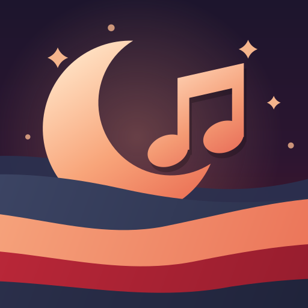
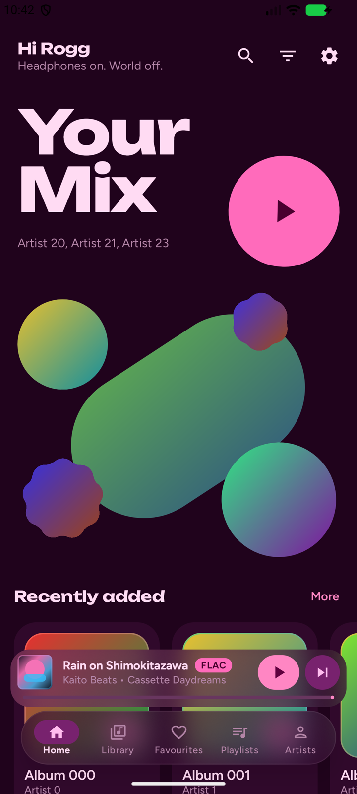
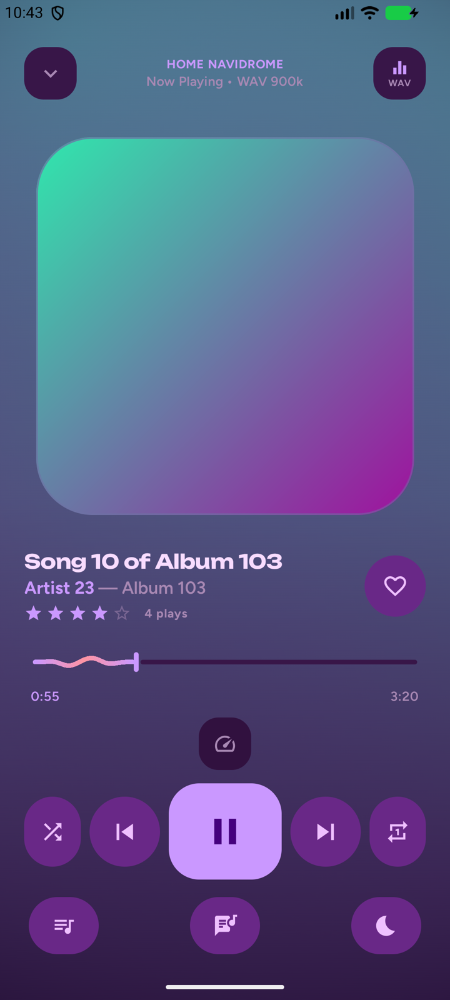
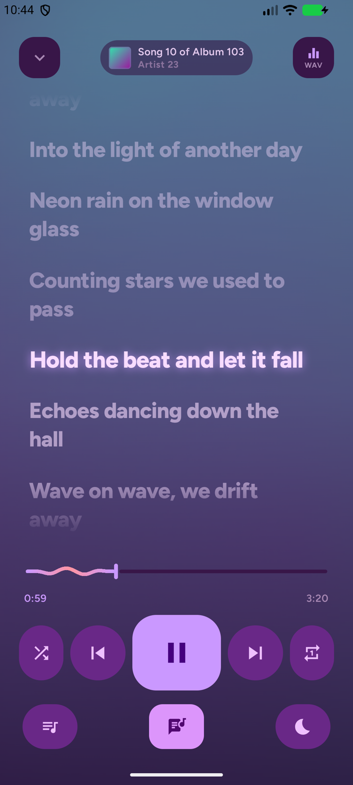
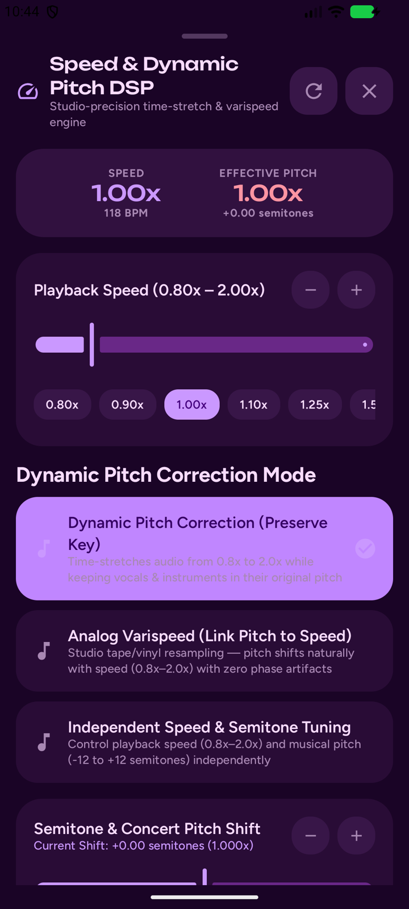
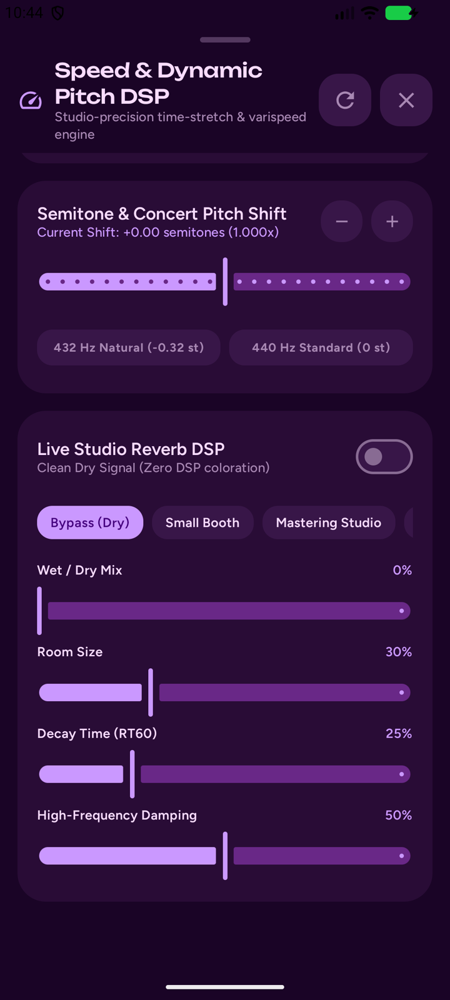
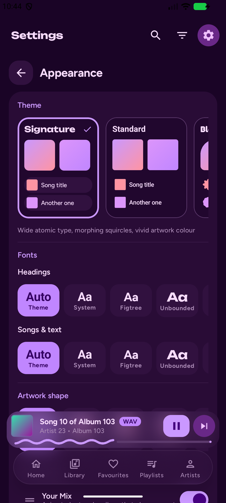
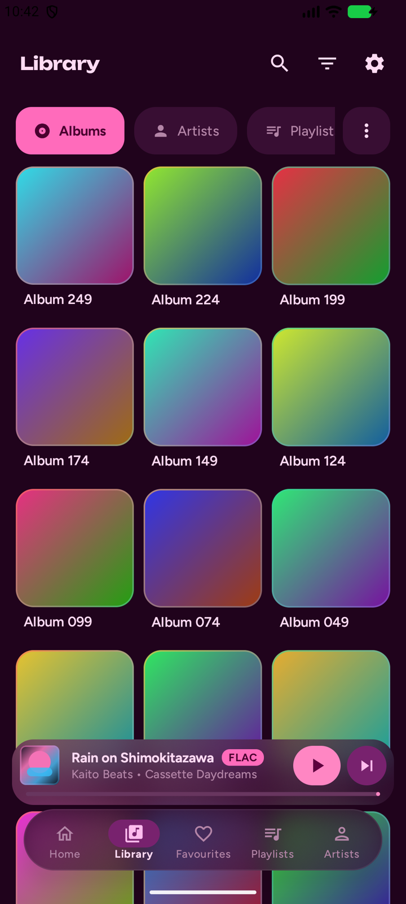

<div align="center">



# Ondalune

**A music player for your own server, made to feel alive.**

Ondalune streams your library from Navidrome or any Subsonic/OpenSubsonic server and plays it
through a hand-tuned audio engine: real-time speed and pitch control, a live studio reverb,
synced lyrics, and a player that takes its colours and motion from whatever is playing.

[Download the latest APK](https://github.com/Roggzuay/ondalune/releases/latest) ·
[Report a bug](https://github.com/Roggzuay/ondalune/issues/new/choose) ·
[Support on Ko-fi](https://ko-fi.com/roggzuay)






</div>

---

## Why Ondalune

Your music already lives on your server. Ondalune is about how it feels when it plays: a home
screen that hands you something to listen to, sound you can bend and shape, and an interface you
can make your own, down to the font on the headings.

## Highlights

### 🎚️ Speed & pitch engine
Change playback speed from **0.80× to 2.00×** and choose how pitch behaves:

- **Preserve key**: time-stretches the audio so vocals and instruments stay in their original key, at any speed.
- **Analog varispeed**: pitch rises and falls with speed, like a tape deck or a turntable.
- **Independent tuning**: set speed and pitch separately, with pitch shifting of up to **±12 semitones**.

There's a live BPM and semitone readout, quick speed chips, and a one-tap **432 Hz** tuning shortcut.

### 🌊 Live studio reverb
A real-time stereo reverb runs on the audio stream itself, not as a filter on top of it. Pick a
room, from a tight **Small Booth** through **Mastering Studio**, **Symphony Hall** and
**Cathedral Arena** to **Dreamscape Wash**, the long shimmering tail made for slowed + reverb
listening. Then shape it yourself with wet/dry mix, room size, decay time and high-frequency
damping. Five-band EQ presets sit alongside it.

<p align="center">

</p>

### 🌙 Your Mix
Home opens on **Your Mix**: a big, playful hero where covers from your own library float in
morphing shapes. Tap play and the shapes shatter, the button swells to fill the screen, and you
land in the player with a fresh mix built from your favourites, your most-played tracks and the
music that sounds like them.

### 🎨 A player that follows the artwork
Colours are read from the actual cover, region by region, so the player, the background, the
lock screen and the notification all match what's playing. Black-and-white covers get a
black-and-white theme instead of a guessed colour. Choose from five animated backgrounds:
Living Artwork, Velvet Mesh, Aurora, Halo and Still. They move with the music and rest when you
pause.

### 🎤 Synced lyrics
Time-synced lyrics from your server scroll with the song, and you can tap any line to jump to it.
Plain lyrics work too. Big home-screen widgets can show the current line.

### ✨ Make it yours
- **Six interface styles**: Signature, Standard, Bloom, Poster, Lounge and Classic. Each changes the type, shapes, spacing and layout, not just the colours.
- **Separate fonts** for headings and for song text, from nine typefaces.
- **Artwork shapes**: squircle, circle, flower, cookie, clover, arch and more, or a mix.
- **Home layout editor**: drag sections into the order you like and hide the ones you don't use.
- **Four layouts** for every collection: Compact, Rows, Tiles and Cards.
- **Material You**, light, dark and pure-black AMOLED themes.
- **Eight launcher icons**, including themed icons on Android 13 and newer.

<p align="center">


</p>

### 👆 Built for your thumbs
- Swipe the cover to skip, or swipe the mini player.
- Swipe a song to favourite it or to play it next.
- Long-press to select songs, then **Select all** to queue, favourite or download a whole list at once.

### 📥 Offline and everywhere else
- **Offline downloads** are stored privately inside the app, with live progress.
- **Smart shuffle** weighs your ratings, favourites and play counts.
- **When the queue runs out**, Ondalune keeps the music going with similar tracks.
- **Sleep timer**, and **scrobbling** back to your server.
- **Background playback** keeps going on the lock screen and through screen-off.
- **Media notification and resizable widgets** with a blurred-artwork background.

## Servers

Ondalune works with servers that speak the Subsonic API, including **Navidrome**, **Gonic** and
**Airsonic-Advanced**, and it uses OpenSubsonic extensions such as structured lyrics when the
server offers them. You can add more than one server and switch between them.

- **Security:** passwords are encrypted on your phone with a key from Android's hardware-backed
  Keystore, and token authentication is used where the server supports it.
- **Home networks:** plain `http://` addresses work (the app tells you they aren't encrypted).
  Servers with a self-signed or private certificate work once you install that certificate on
  your phone.

## Privacy

No ads, no analytics, no trackers, no account. Ondalune connects only to the servers you add
(and image links they hand out), to Wikipedia for missing artist bios, and to Ko-fi if you tap
the support button. See
[PRIVACY.md](PRIVACY.md).

## Install

1. Download `Ondalune-<version>.apk` from [Releases](https://github.com/Roggzuay/ondalune/releases).
2. Open it on your phone and allow installs from your browser or file manager when Android asks.
3. Add your server, or tap **Start Listening** to try the built-in demo library first.

Requires Android 7.0 or newer. Releases are signed with this certificate (SHA-256):

```
2B:46:08:12:5F:82:67:85:2D:26:C8:0B:C6:56:90:A1:FE:42:55:DE:5B:EC:A9:F4:B7:AF:A5:F7:5E:35:74:30
```

Updates install over the previous version, so your settings and downloads stay put.

## Build from source

You need JDK 21 and the Android SDK with platform 37 (Android 17).

```sh
git clone https://github.com/Roggzuay/ondalune.git
cd ondalune
./gradlew assembleDebug          # app/build/outputs/apk/debug/
./gradlew testDebugUnitTest      # unit tests
```

`./gradlew assembleRelease` builds the optimized release APK. It's signed only if a
`keystore.properties` file exists in the project root (never commit it):

```properties
storeFile=/path/to/your-release.jks
storePassword=…
keyAlias=…
keyPassword=…
```

The launcher icons are generated by `tools/icongen.py`; run it to change colours or add a variant.

## Contributing

Bug reports and ideas are very welcome. Please open an issue first for anything bigger than a
small fix, so we can agree on the approach. See [CONTRIBUTING.md](CONTRIBUTING.md).
For security problems, please follow [SECURITY.md](SECURITY.md) instead of opening a public issue.

## Support

Ondalune is free and stays free. If it has become part of your day,
[a coffee on Ko-fi](https://ko-fi.com/roggzuay) is a lovely way to say thanks and keeps the
updates coming.

## Licence

Ondalune is free software, released under the [GNU General Public License v3.0 or later](LICENSE).
Bundled fonts are under the SIL Open Font License 1.1, and the libraries it uses are under the
Apache 2.0 or MIT licences. Full notices are in [NOTICE.md](NOTICE.md) and inside the app under
**Settings → About & licences**.

Subsonic, OpenSubsonic, Navidrome, Gonic and Airsonic are trademarks or names of their
respective owners. Ondalune is an independent project and isn't affiliated with or endorsed by
any of them.
